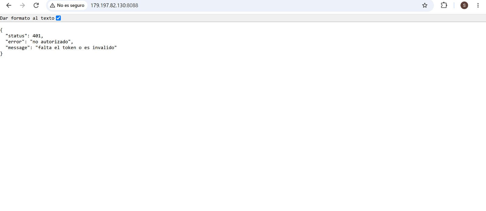
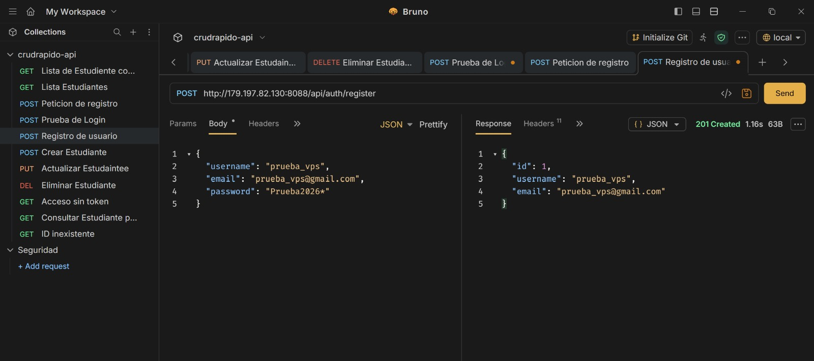
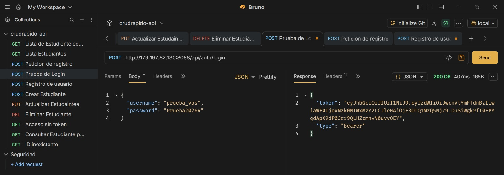
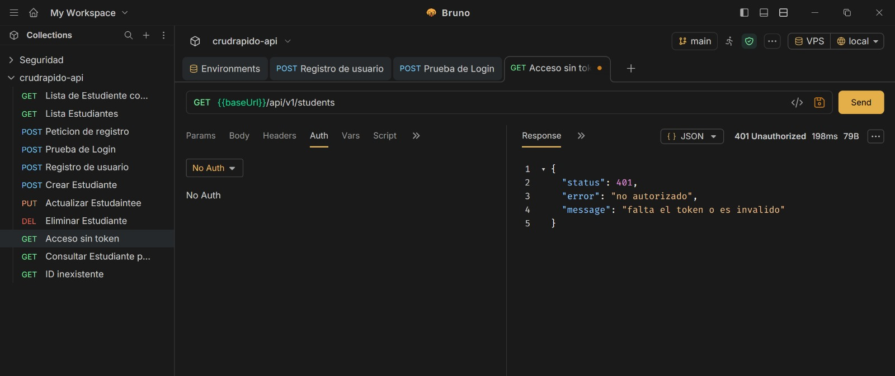
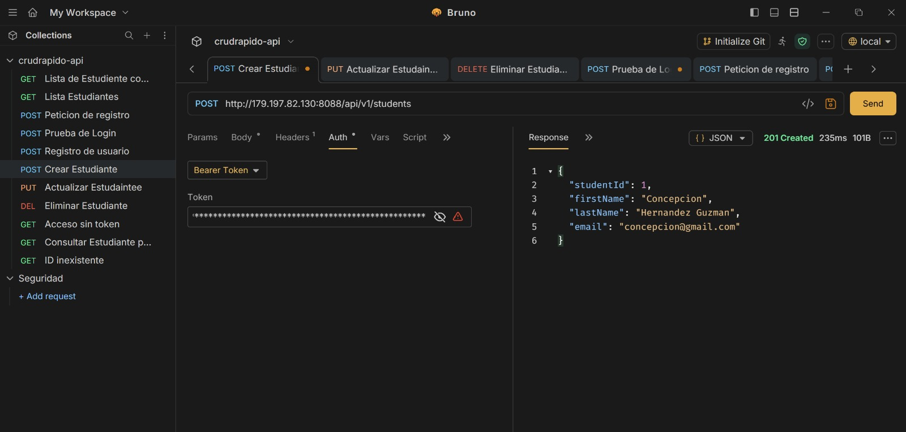
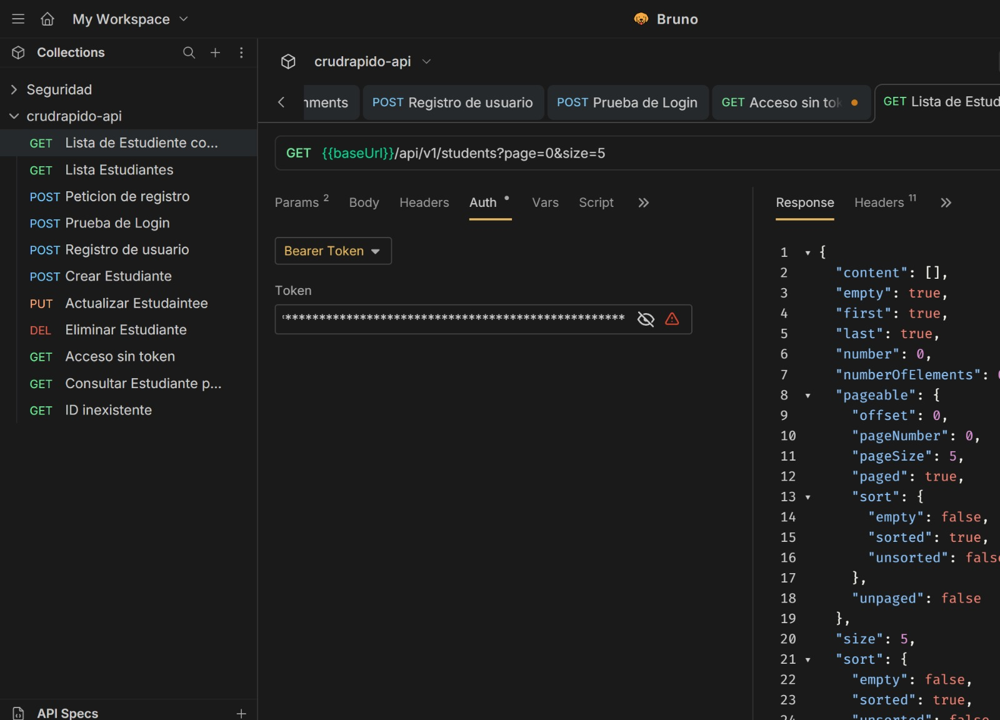
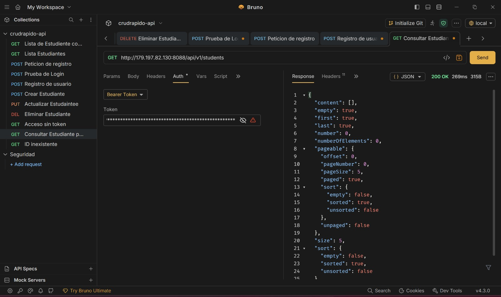
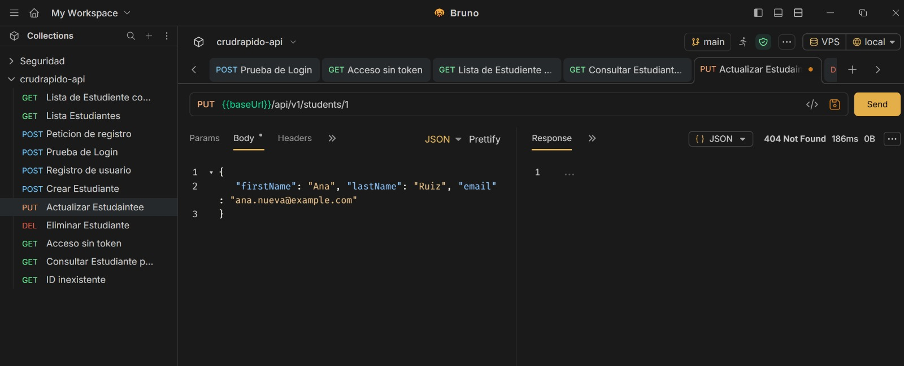
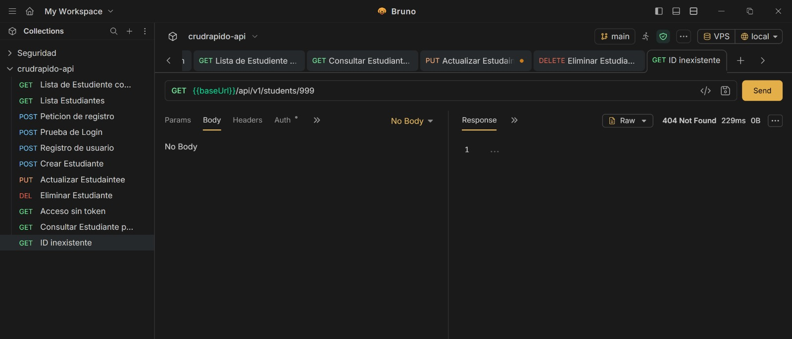

# Actividad 4: API REST con Spring Boot, Spring Security y JWT

**Autora:** Escarleth Hernández Guzmán Concepción

**Repositorio:** https://github.com/HernandezGuzmanConcepcionEscarleth/CEHGact4_t4

**API en el VPS:** http://179.197.82.130:8088

## Descripción

API REST pura (sin vistas, siempre responde JSON) hecha con Spring Boot. Incluye un CRUD de estudiantes protegido con autenticación real mediante Spring Security y JWT. Los datos de entrada se controlan con DTOs y se validan con Bean Validation. Todo se probó con Bruno, primero en local y después en mi VPS.

## Tecnologías

- Java 21
- Spring Boot 4.1.2
- Spring Web MVC, Spring Data JPA (Hibernate)
- Spring Security
- JWT (librería jjwt 0.12.6)
- Bean Validation (`@Valid`, `@NotBlank`, `@Email`, `@Size`)
- MySQL 8
- Bruno (pruebas de la API)

## Estructura del proyecto

```
src/main/java/com/crudrapido/crudrapido/
├── controller/   AuthController, StudentController
├── dto/          StudentRequest, StudentResponse, RegisterRequest, LoginRequest, AuthResponse, UserResponse
├── entity/       Student, User
├── exception/    GlobalExceptionHandler
├── repository/   StudentRepository, UserRepository
├── security/     JwtService, JwtAuthFilter, SecurityConfig
└── service/      StudentService
crudrapido-apiBRUNO/   colección de Bruno con todas las peticiones
capturas/              capturas de pantalla de las pruebas
```

## Cómo funciona la autenticación

1. **Registro** (`POST /api/auth/register`): guarda al usuario con la contraseña encriptada con BCrypt. La respuesta nunca incluye el password.
2. **Login** (`POST /api/auth/login`): si las credenciales son correctas devuelve un token JWT (dura 1 hora).
3. **CRUD**: cada petición a `/api/v1/students` debe llevar el encabezado `Authorization: Bearer <token>`. Un filtro (`JwtAuthFilter`) valida la firma y la expiración del token. Sin token, o con uno inválido, responde **401**.

Las rutas `/api/auth/**` son públicas; todo lo demás exige token.

## Endpoints

| Método | Ruta | Descripción | Auth | 
|---|---|---|---|---|
| POST | `/api/auth/register` | Registrar usuario | No | 
| POST | `/api/auth/login` | Iniciar sesión, devuelve token | No | 
| GET | `/api/v1/students?page=0&size=5` | Listar estudiantes (paginado) | Sí | 
| GET | `/api/v1/students/{id}` | Ver un estudiante | Sí | 
| POST | `/api/v1/students` | Crear estudiante | Sí | 
| PUT | `/api/v1/students/{id}` | Actualizar estudiante | Sí | 
| DELETE | `/api/v1/students/{id}` | Eliminar estudiante | Sí | 

### Ejemplos de body

Registro:
```json
{ "username": "escarleth", "email": "escarleth@gmail.com", "password": "123456789" }
```

Login:
```json
{ "username": "escarleth", "password": "123456789" }
```

Crear o actualizar estudiante:
```json
{ "firstName": "Ana", "lastName": "Ruiz", "email": "ana@example.com" }
```

Si los datos son inválidos, la API responde **400** con el detalle por campo:
```json
{
  "status": 400,
  "error": "validacion fallida",
  "errors": { "firstName": "el nombre es obligatorio", "email": "el email no tiene un formato valido" }
}
```

## Cómo ejecutarlo en local

1. Crear la base de datos en MySQL:
   ```sql
   CREATE DATABASE crud_rapido;
   ```
2. Definir las variables de entorno (no se suben al repositorio):

   | Variable | Descripción |
   |---|---|
   | `DB_PASSWORD` | Contraseña de MySQL |
   | `JWT_SECRET` | Secreto para firmar tokens (mínimo 32 caracteres) |
   | `DB_URL` | Opcional. Por defecto `jdbc:mysql://localhost:3306/crud_rapido` |
   | `DB_USER` | Opcional. Por defecto `root` |

3. Ejecutar:
   ```bash
   ./mvnw spring-boot:run
   ```
4. La API queda en `http://localhost:8088`.

## Despliegue en el VPS

- Compilé el jar con `./mvnw clean package -DskipTests` y lo subí a una carpeta nueva del VPS: `/opt/act4`.
- Lo ejecuto como servicio de systemd (`act4.service`) en el **puerto 8088**, sin afectar las actividades anteriores, que siguen corriendo en sus puertos.
- Usa su propia base de datos (`crud_rapido_act4`) y un usuario de MySQL exclusivo para la app.
- Las credenciales y el secreto JWT se pasan como variables de entorno del servicio, no están en el código.
- URL base: **http://179.197.82.130:8088**


## Pruebas con Bruno

La colección está en la carpeta `crudrapido-apiBRUNO`. Tiene dos entornos (`local` y `vps`) con la variable `baseUrl`, y el login guarda el token automáticamente para usarlo en las demás peticiones.

### 1. Registro de usuario (201)


### 2. Login con token (200)


### 3. Acceso sin token (401)


### 4. Crear estudiante (201)


### 5. Listar estudiantes con paginación (200)


### 6. Consultar un estudiante por id (200)


### 7. Actualizar estudiante 


### 10. Estudiante inexistente (404)


## Seguridad

- Las contraseñas se guardan con BCrypt, nunca en texto plano.
- Ninguna respuesta expone el password (uso `UserResponse` y `StudentResponse`).
- El secreto JWT y la contraseña de la base de datos viven en variables de entorno.
- Las sesiones son stateless: la autenticación depende solo del token.
